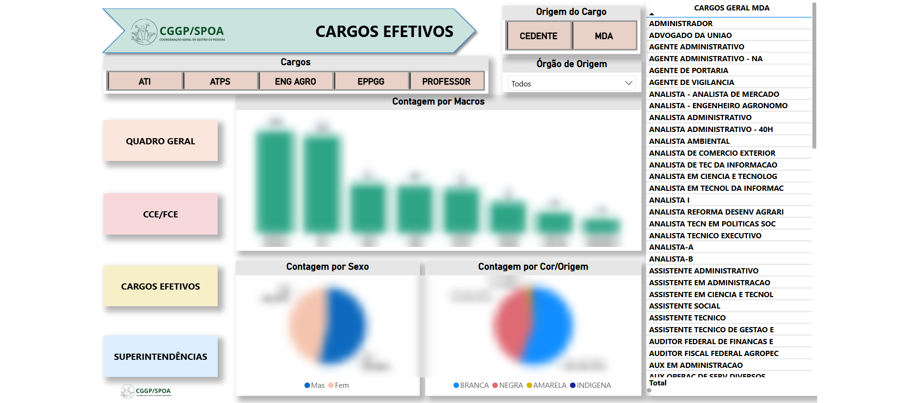
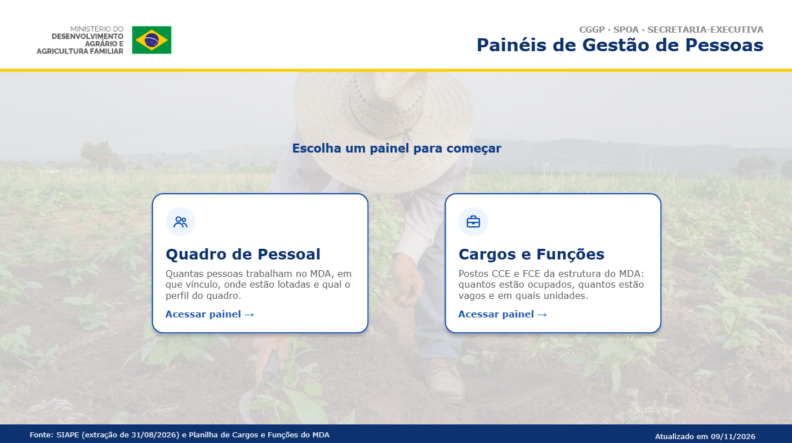
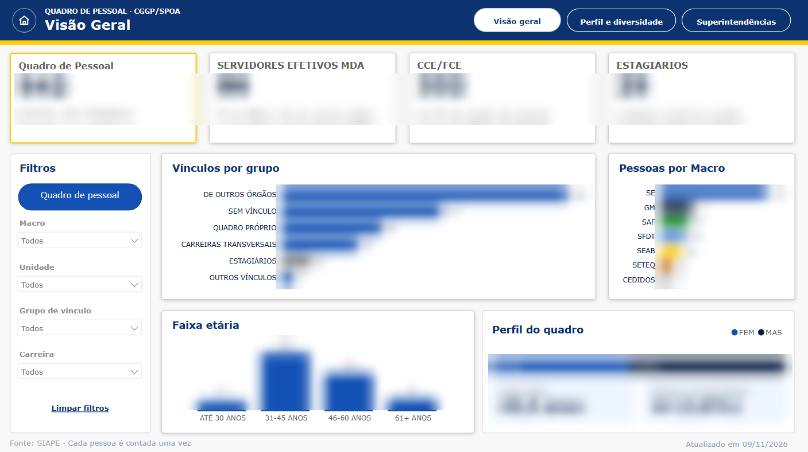
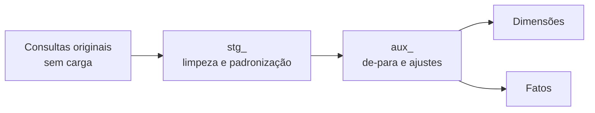
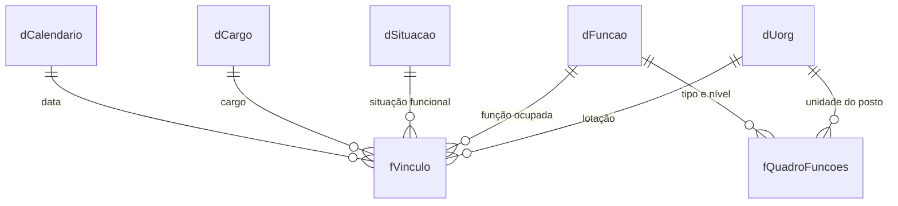

# BI de Gestão de Pessoas – CGGP/SPOA (Ministério do Desenvolvimento Agrário)

Projeto de Business Intelligence que desenvolvi do zero no Power BI para a Coordenação-Geral de Gestão de Pessoas (CGGP/SPOA) do Ministério do Desenvolvimento Agrário e Agricultura Familiar. Ele substituiu um painel antigo, com visual pouco claro e publicado na web com acesso público.

> **Sobre este repositório.** Os dados são de pessoal do governo, então o arquivo .pbix e os dados reais **não** estão aqui. As capturas de tela têm os valores ocultados, e os trechos de DAX e Power Query são exemplos simplificados das medidas e transformações usadas, com nomes de colunas adaptados.

## Objetivo

Dar à gestão uma visão confiável do quadro de pessoal e da ocupação de cargos e funções (CCE/FCE), com conferência entre as fontes oficiais: o SIAPE e a planilha de cargos e funções da CGGP.

## Antes e depois

| Painel antigo | Novo painel |
|---|---|
|  |  |

## Fontes de dados

- Relatório de servidores extraído do SIAPE/DW
- Planilha de cargos e funções da CGGP (postos CCE/FCE por unidade)
- Bases auxiliares de funções e de titulares e substitutos

## ETL em camadas (Power Query)

- **Originais:** preservadas e sem carga no modelo, para rastrear qualquer número até a fonte.
- **stg_:** limpeza e padronização de textos, códigos de função, siglas de unidade e situação do posto.
- **aux_:** de-para de códigos e unidades e ajuste de Macro.
- **Correções de dados tratadas:** SIORG duplicado, siglas inconsistentes, unidades sem Macro, códigos de função nulos. A ordem de escolaridade e as faixas etárias foram criadas no Power Query para permitir "Classificar por coluna" sem dependência circular.

Exemplos: [`power-query/exemplos.m`](power-query/exemplos.m)

## Modelagem dimensional

Esquema em constelação, com dois fatos que compartilham as dimensões de unidade e de função:

- **fVinculo:** pessoas e vínculos (uma linha por vínculo).
- **fQuadroFuncoes:** postos CCE/FCE da estrutura.
- **dUorg:** unidades, Macro e superintendências. **dFuncao:** tipo e nível da função.
- **dSituacao:** situação funcional, grupo e público (quadro ou estagiários). **dCargo:** cargos.
- **dCalendario:** criada em DAX e marcada como tabela de datas.
- Relacionamentos 1:N com filtro em direção única.
- O CPF fica apenas como chave oculta, usada para contagem distinta de pessoas.

## Medidas DAX

Exemplos: [`dax/medidas.dax`](dax/medidas.dax)

- Quadro de pessoal com `ISFILTERED`, reagindo ao botão Quadro/Estagiários.
- Postos totais, ocupados e vagos e % de ocupação.
- Unidades com postos, unidades com vaga e Macro com mais vagas (`TOPN` + `CONCATENATEX`).
- Pessoas com função no SIAPE (`CALCULATE` + `KEEPFILTERS`) e diferença entre o SIAPE e a planilha.
- Legendas dinâmicas dos cartões com `FORMAT` (por exemplo, "X CCE e Y FCE" e "% do quadro").
- Data de atualização gerada no Power Query, no fuso de Brasília.

## Design

- Design system próprio no padrão gov.br (cores oficiais e Verdana), aplicado por um tema JSON do Power BI: [`design-system/tema-govbr.json`](design-system/tema-govbr.json).
- Protótipo navegável feito antes da construção.
- Capa com navegação por botões e dois painéis.

**Páginas (7):**
- Capa
- Quadro de Pessoal: Visão geral · Perfil e diversidade · Superintendências
- Cargos e Funções: Visão dos postos · Detalhe por unidade (matriz Macro > unidade com formatação condicional) · SIAPE x planilha (controle de qualidade entre fontes)

## Publicação e governança

- Publicado em workspace da SPOA e distribuído por aplicativo do Power BI, com acesso restrito. O painel antigo usava "Publicar na Web"; o novo não usa.
- Exportação limitada a dados resumidos, em respeito à LGPD.
- Atualização agendada.
- Documento técnico entregue à CGGP com as inconsistências encontradas nas bases e a validação dos totais.

## O que aprendi

Modelagem dimensional com mais de um fato, ETL em camadas, DAX com contexto de filtro, design de dashboards para gestão e governança de dados com LGPD na publicação.

## Ferramentas

Power BI · Power Query (M) · DAX · SIAPE/DW · Excel

## Autora

Giovana Fontoura · [LinkedIn](https://www.linkedin.com/in/giovana-fontoura/) · [GitHub](https://github.com/gifontoura)
